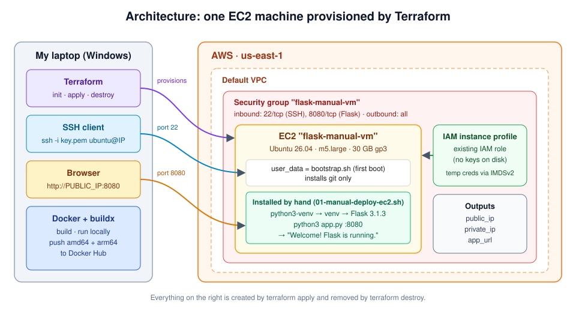
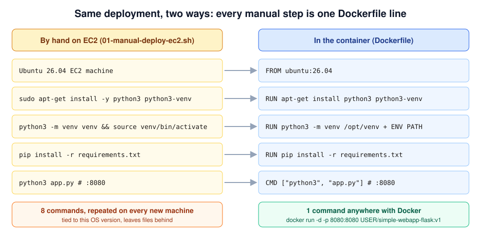
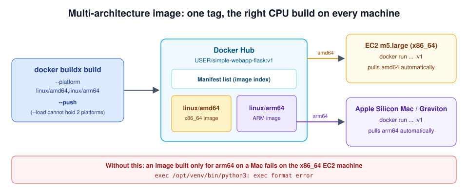

# Flask Deploy: EC2 by Hand vs Docker


A self-learning project where I deploy the same Flask web app two ways and compare them:

1. **By hand** on an Ubuntu 26.04 EC2 machine that I provision with Terraform.
2. **As a container image**, built for both `amd64` and `arm64` and published to Docker Hub.

I wanted to see for myself how many manual steps a "simple" deployment really takes, and how a Dockerfile turns all of them into one repeatable `docker run`.



---

## Project stages

| # | Stage | Tools | Result |
|---|---|---|---|
| 1 | Provision the EC2 machine | Terraform, AWS | Ubuntu 26.04 on `m5.large` in `us-east-1`, SSH and port 8080 open |
| 2 | Inspect the bare machine | SSH, cloud-init | Git present, Python venv support missing (on purpose) |
| 3 | Deploy Flask by hand | apt, venv, pip | App live on `http://<public_ip>:8080` |
| 4 | Run the same app in Docker | Docker | Same page on `http://localhost:8080` |
| 5 | Build and push a multi-arch image | Docker buildx, Docker Hub | One `v1` tag with `linux/amd64` and `linux/arm64` |
| 6 | Tear it all down | Terraform | `terraform destroy` removes every AWS resource |

## Repository layout

```
.
├── terraform/
│   ├── main.tf          # AMI lookup, default VPC, security group, EC2 instance, outputs
│   ├── variables.tf     # key_name (required), instance_profile (optional)
│   └── bootstrap.sh     # user_data: installs git only
├── scripts/
│   ├── 01-manual-deploy-ec2.sh    # Part 1: manual deployment, run on the EC2 machine
│   └── 02-container-deploy.sh     # Part 2: Docker build, run and multi-arch push, run on the laptop
├── app/                 # Flask app: app.py, Dockerfile, requirements.txt
└── docs/images/         # architecture diagrams
```

## Prerequisites

- An AWS account with an EC2 key pair (`.pem` downloaded)
- Terraform, AWS CLI v2, Git and Docker on your laptop

---

## 1. Provision the EC2 machine with Terraform

```bash
cd terraform
terraform init
terraform apply          # prompts for var.key_name
terraform output         # public_ip, private_ip, app_url, next_step

chmod 400 my-key.pem
ssh -i my-key.pem ubuntu@<public_ip>
```

**What Terraform builds**

- Looks up the latest Canonical Ubuntu 26.04 `amd64` AMI.
- Uses the default VPC, and picks a subnet in an availability zone that actually offers `m5.large` (`us-east-1e` does not).
- Creates a security group allowing inbound 22 (SSH) and 8080 (Flask).
- Launches one EC2 instance with a 30 GB gp3 disk, IMDSv2 required, and `bootstrap.sh` as `user_data`.
- Outputs `public_ip`, `private_ip`, `app_url` and a ready-made SSH command.

**Why `key_name` has no default**

An EC2 key pair belongs to one person in one AWS account and region, and only that person holds the matching `.pem` file. No value is correct for everyone, so the variable has no default. A Terraform variable without a default is required, so `terraform apply` stops and asks for it. It can also be passed with `-var key_name=...` or a `terraform.tfvars` file, which `.gitignore` keeps out of Git.

**What the IAM instance profile gives the machine**

An instance profile attaches an IAM role to an EC2 instance. Anything on the machine (AWS CLI, SDKs, containers) can then get short-lived credentials from the instance metadata service, with no access keys stored on disk. `http_tokens = "required"` forces IMDSv2, and a hop limit of 2 lets containers on the host reach the metadata service too. Set `instance_profile` to the name of an existing profile, or leave it `null`.

---

## 2. The bare machine

```bash
git --version            # works: installed by bootstrap.sh
python3 -m venv venv     # fails: ensurepip is not available

sudo apt-get update -y
sudo apt-get install -y python3-venv
python3 -m venv venv     # now works
```

**Why `bootstrap.sh` installs Git only**

On purpose. The machine gets just enough to clone the code: no Python venv, no pip, no Flask, no Docker. Every deployment step then has to be done by hand and counted, so it can be compared line by line with the Dockerfile.

**What `user_data` does on first boot**

`user_data` is a script handed to the instance at launch. On the first boot, cloud-init runs it once as root, before anyone logs in. Here it runs `apt-get update`, installs Git and writes a login message. Its output goes to `/var/log/cloud-init-output.log`, and it does not run again on later reboots.

---

## 3. Deploy Flask by hand on EC2

From `scripts/01-manual-deploy-ec2.sh`:

```bash
git clone https://github.com/TDPATEL1224/flask-deploy-ec2-vs-docker   # 1
cd flask-deploy-ec2-vs-docker/app                                      # 2
sudo apt-get update -y                                                 # 3
sudo apt-get install -y python3 python3-venv                           # 4
python3 -m venv venv                                                   # 5
source venv/bin/activate                                               # 6
pip install -r requirements.txt                                        # 7
python3 app.py                                                         # 8  serves on 0.0.0.0:8080

curl http://localhost:8080      # from a second SSH session
# browser: http://<public_ip>:8080
```

**8 commands** to get one app running, and every one of them has to be repeated on every new machine.

**Why not `pip3 install flask`?**

Since Ubuntu 24.04, the system Python is marked *externally managed* (PEP 668). Its packages belong to `apt`, and parts of the OS depend on them, so `pip3 install flask` is refused with an `externally-managed-environment` error. Forcing it with `--break-system-packages` can overwrite files `apt` owns and break system tools.

**What `python3 -m venv` changes**

It creates a folder (`venv/`) with its own `python`, its own `pip` and an empty `site-packages`. `source venv/bin/activate` puts `venv/bin` first on `PATH`, so `pip install` lands inside that folder instead of the system Python. The app gets exactly the versions in `requirements.txt`, the OS stays untouched, and deleting the folder removes everything.

---

## 4. The same app as a container

From `scripts/02-container-deploy.sh`:

```bash
cd app
docker build -t simple-webapp-flask:v1 .
docker run -d --name webapp -p 8080:8080 simple-webapp-flask:v1
curl http://localhost:8080
```

Each Dockerfile line is one of the manual steps from section 3:



---

## 5. Multi-architecture image

```bash
docker login
docker buildx build --platform linux/amd64,linux/arm64 \
  -t "<dockerhub-username>/simple-webapp-flask:v1" --push .

docker buildx imagetools inspect "<dockerhub-username>/simple-webapp-flask:v1"
# Manifests: lists both linux/amd64 and linux/arm64
```



**Why `--push` and not `--load`**

A multi-platform build produces a *manifest list*: one tag pointing to a separate image per CPU. `--load` copies the result into the local Docker image store, which can hold only one platform per tag, so it cannot load both. `--push` sends the manifest list and both images straight to the registry, and each machine that pulls the tag gets the one matching its CPU.

**Why a Mac-built image can fail on EC2**

An Apple Silicon Mac is `arm64`, so a plain `docker build` there produces an `arm64` image. The EC2 machine (`m5.large`) is `x86_64`. The binaries inside are compiled for the wrong CPU, and the container dies with `exec format error`. Building both platforms under one tag avoids it.

---

## 6. Clean up

```bash
docker rm -f webapp
cd terraform
terraform destroy
```

---

## What I learned

- Terraform turns a machine into code I can create and delete in minutes, with inputs like `key_name` made explicit.
- A manual deployment is 8 commands that depend on the exact OS version and leave files behind.
- A Dockerfile holds those same steps, so one `docker run` repeats the whole deployment anywhere.
- Multi-arch images matter as soon as Apple Silicon laptops and x86 servers are mixed.

---

The Flask app in `app/` is based on the MIT-licensed [simple-webapp-flask](https://github.com/mmumshad/simple-webapp-flask) (see `app/LICENSE`).
